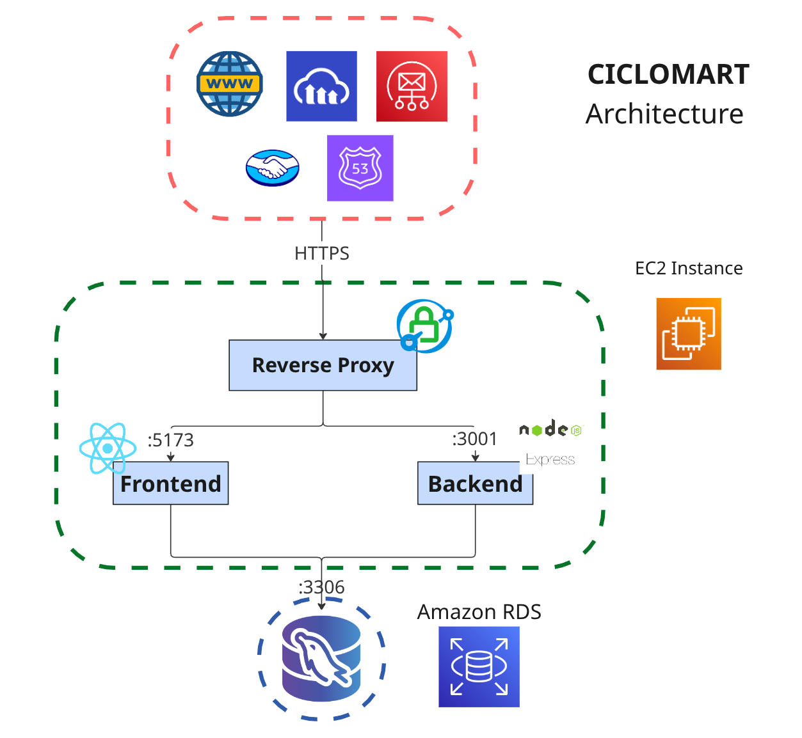

# CicloMart (Backend) - Buy and Sell Bicycles and Cycling Spare Parts

[](README.md) [](README.es.md)

- App Link: [ciclomart.com](https://ciclomart.com)
- User Instructions: [Canva Presentation](https://www.canva.com/design/DAG23e0XYS4/qg8KUY0ukJcyz4XLgN-wlw/edit?utm_content=DAG23e0XYS4&utm_campaign=designshare&utm_medium=link2&utm_source=sharebutton)
- Hours Listing: [Google Spreadsheet](https://docs.google.com/spreadsheets/d/16X9bC5Drs2z4pwJ-D0CnR451mCKMRXd3i1B2WLkOS3M/edit?usp=sharing)

- Ciclomart Frontend: [Github Repository](https://github.com/w1sec0d/ciclomart_frontend)
- Ciclomart Backend: [Github Repository](https://github.com/w1sec0d/ciclomart_backend)

## Description

CicloMart is a web application for buying and selling bicycles and cycling spare parts. It offers a unique, secure, and reliable experience by requiring legal ownership documentation from sellers. Users can find exactly what they're looking for using advanced filters such as transmission groups, suspension, weight, rims, brakes, and many other relevant characteristics.

## Demo


<!-- ### User Instructions -->

## System Architecture



## Team Members

- **Juan David Madrid Contreras** - [JuMad-SE](https://github.com/JuMad-SE)
- **Carlos David Ramirez Muñoz** - [w1sec0d](https://github.com/w1sec0d)
- **Johan David Rodriguez Gutierrez** - [Homeroso](https://github.com/Homeroso)
- **Ronald Daniel Jacanamejoy Mutumbajoy** - [RonaldDaniel20](https://github.com/RonaldDaniel20)

## Developer Installation

1. Clone the repository:

```bash
git clone https://github.com/RonaldDaniel20/CicloMart_Back.git
cd CicloMart_Back
```

2. Install dependencies:

```bash
npm install
```

3. Run the development server:

```bash
npm run dev
```

To run the project correctly, you must include a .env file in the project root with the following environment variables:

### Database Variables

- DB_PORT: Database port
- DB_HOST: Database host
- DB_USER: Database user
- DB_PASSWORD: Database password
- DB_NAME: Database name

### Frontend Variables

- FRONTEND_INTERNAL_URL: Frontend URL (internal address for communication between backend and frontend)
- FRONTEND_EXTERNAL_URL: Frontend URL (external address, must be publicly accessible. This sets up mercadopago callback URL)

### Authentication Variables

- JWT_SECRET: JSON Web Token secret key

### Email Variables (required to send verification codes)

- EMAIL_ONLINE: Email for email sending
- PASSWORD_ONLINE: Email password for email sending
- EMAIL_HOST: Email host
- EMAIL_PORT: Email port

### MercadoPago Variables (required to set up payment gateway)

- BACKEND_URL: Backend URL (must be publicly accessible from mercadopago webhooks)
- MP_ACCESS_TOKEN: MercadoPago (Payment Gateway) access token
- MP_CLIENT_ID: MercadoPago (Payment Gateway) client id
- MP_CLIENT_SECRET: MercadoPago (Payment Gateway) client secret
- MP_PUBLIC_KEY: MercadoPago (Payment Gateway) public key
- MP_REDIRECT_URL: MercadoPago (Payment Gateway) redirect URL

### Encryption Variables (required for sensitive data encryption)

**Basic (single key):**

- AES_KEY: AES-256 encryption key (exactly 32 characters). Generate with: `openssl rand -base64 24 | head -c 32`

**Advanced (key rotation):**

- AES_KEY_V1, AES_KEY_V2, etc.: Versioned keys for rotation
- AES_CURRENT_VERSION: Current version for new encryptions (e.g., "v2")

**AWS KMS (production recommended):**

- KEY_PROVIDER: Set to "aws-kms" to use AWS KMS
- AWS_REGION: AWS region (default: us-east-1)
- AWS_KMS_KEY_ID: KMS key ARN or alias

For more details, see:

- [docs/ENCRYPTION.md](docs/ENCRYPTION.md) - Encryption basics
- [docs/KEY_ROTATION.md](docs/KEY_ROTATION.md) - Key rotation and AWS KMS

These parameters must match a MySQL database instance, which can be initialized with the script in `./database/dbCreation.sql`

## License

This project is licensed under the MIT License. See the [LICENSE](LICENSE) file for details.

[](https://opensource.org/licenses/MIT)
